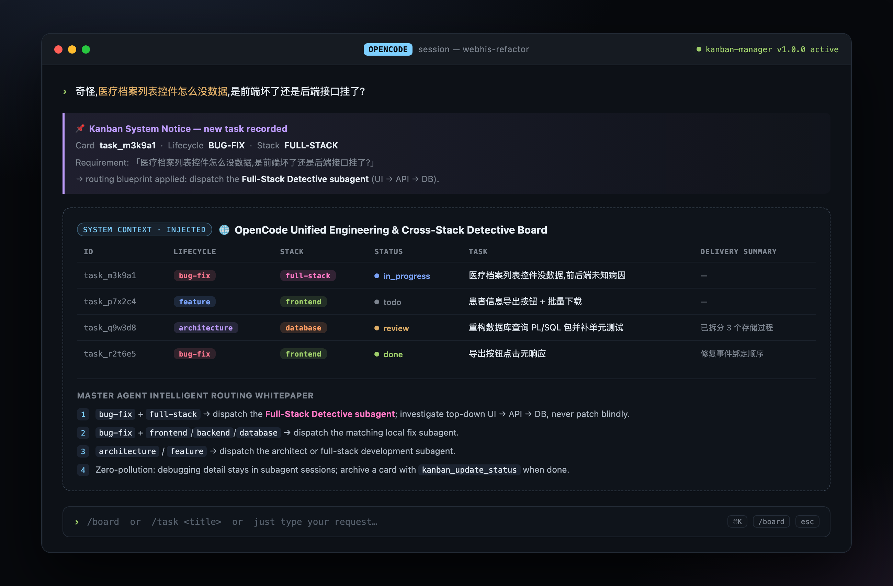

# opencode-kanban-manager

A single **OpenCode V2** plugin that fuses two ideas that usually live apart:

1. **Engineering lifecycle classification** — `architecture` | `feature` | `bug-fix` | `testing` | `docs`
2. **Cross-stack routing** — `frontend` | `backend` | `database` | `full-stack`

Every request you send is captured on a persistent kanban board, classified on *both*
dimensions, and surfaced back to the master agent as a routing blueprint. The agent can
then dispatch the correct expert subagent automatically — and a symptom whose root cause
is unknown is classified as `bug-fix + full-stack` and flagged for the **Full-Stack
Detective** subagent.

The board lives only in the master context. All debugging detail stays inside subagent
sessions, so the orchestrator's context stays clean.

## Preview



## Why one plugin, not two

In real development a task always has *both* a lifecycle stage and a technical-stack
boundary. Splitting them into two plugins forces constant config switching. This plugin
derives both at once and uses them together to pick a subagent.

## Install

### From git (recommended)

```sh
opencode plugin add github:tomzio/opencode-kanban-manager
```

### From a local checkout

Drop the package directory into your project's `.opencode/plugins/` folder, or point the
`plugins` array at it:

```jsonc
{
  "$schema": "https://opencode.ai/config.json",
  "plugins": ["./.opencode/plugins/kanban-manager"]
}
```

Options can be passed with the object form:

```jsonc
{
  "plugins": [
    {
      "package": "opencode-kanban-manager",
      "options": { "autoCapture": true, "maxBoardRows": 30 }
    }
  ]
}
```

## Usage

Just talk to OpenCode normally. Every non-command message becomes a card, classified
automatically:

| You type | Lifecycle | Stack |
|:---|:---|:---|
| 医疗档案列表控件怎么没数据,是前端坏了还是后端接口挂了? | `bug-fix` | `full-stack` |
| 新加一个患者信息导出的前端按钮和批量下载功能 | `feature` | `frontend` |
| 把这部分的数据库查询 PL/SQL 包重构一下,顺便补个单元测试 | `architecture` | `database` |

### Commands

- `/board` — render the entire board.
- `/task <title>` — explicitly record a card.

### Tools exposed to the agent

- `kanban_update_status` — update a card's status and delivery summary (use to archive).
- `kanban_add_task` — create a card, optionally forcing lifecycle/stack.
- `kanban_list` — list cards, optionally filtered by status.

## Routing blueprint (injected into the model context)

1. `bug-fix` + `full-stack` (unknown root cause) → **Full-Stack Detective subagent**,
   investigating top-down `UI → API → DB`. No blind patching.
2. `bug-fix` + `frontend`/`backend`/`database` → the matching local fix subagent.
3. `architecture` / `feature` → architect or full-stack development subagent.
4. Zero-pollution: keep debugging detail inside subagent sessions; archive with
   `kanban_update_status` when done.

## Options

| Option | Type | Default | Description |
|:---|:---|:---|:---|
| `autoCapture` | `boolean` | `true` | Record every non-command user message as a card. |
| `maxBoardRows` | `number` | `30` | Max active rows injected into the context. |
| `storagePrefix` | `string` | `"kanban/tasks/"` | Storage key prefix. |

## How it works (V2 API)

- `Plugin.define({ id, setup })` — plugin entrypoint.
- `ctx.storage` — plugin-scoped durable JSON persistence for the cards (no sqlite needed).
- `ctx.tool.transform(editor => editor.add(...))` — registers the kanban tools.
- `ctx.session.hook("prompt", ...)` — captures user input and appends the routing notice
  (the original request is preserved).
- `ctx.session.hook("context", ...)` — injects the board + routing blueprint into every
  model request.

## Development

```sh
npm install
npm run typecheck
```

## License

MIT
